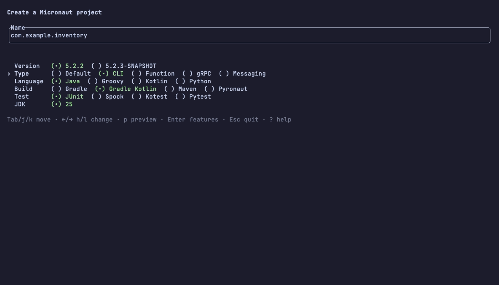
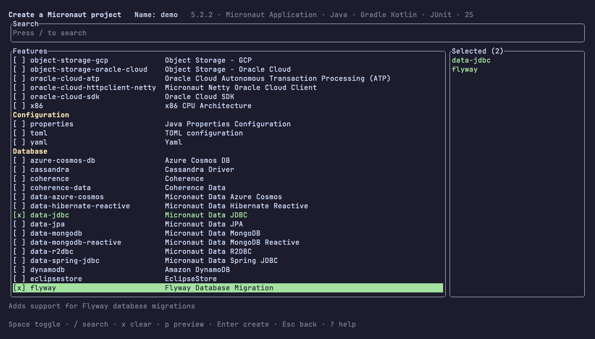
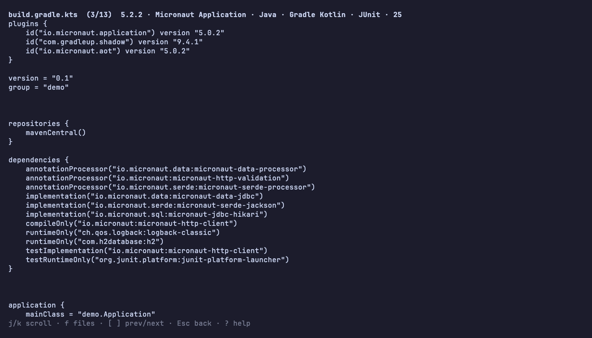
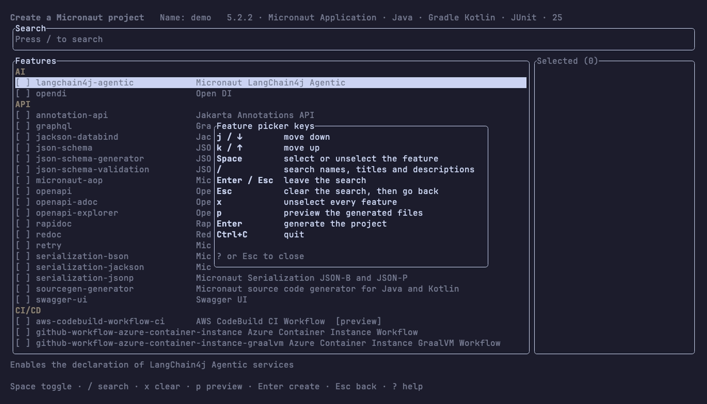

# mtui

[](https://github.com/leeturner/micronaut-launch-tui/actions/workflows/build.yml)

A terminal UI for creating Micronaut projects through
[Micronaut Launch](https://launch.micronaut.io), built with
[TamboUI](https://tamboui.dev).


## Why

The hardest part of creating a Micronaut project is finding the right features:
there are hundreds of them. `mtui` puts them in one searchable list, so you
type a few letters, press Space and move on, without leaving the terminal or
unzipping a download.

It was inspired by Dan Vega's
[spring-initializr-tui](https://github.com/danvega/spring-initializr-tui), which
does the same for Spring Boot.

## Features

- Search every feature by name, title or description, and see what you have
  selected at all times
- Choose the application type, language, build tool, test framework and JDK
- Switch between the latest Micronaut release and the current snapshot
- Preview the generated files before creating anything
- Unzip the project straight into the current directory
- Open the project with your editor or IDE once it is created
- Press `?` on any screen to see its keys

## Screenshots

### Name and options

Type the project name, then pick the Micronaut version, application type,
language, build tool, test framework and JDK.



### Features

Press `/` to search, Space to select. The features you have chosen stay
listed on the right.



### Preview

Press `p` to browse the files Launch would generate, with `f` to jump to a
file by name.



### Help

Press `?` on any screen for every key it understands.



## Install

With the [GitHub CLI](https://cli.github.com), this installs or updates `mtui`
in `~/.local/bin` (make sure it's on your `PATH`). On Linux, use
`'*linux-x86_64*'` as the pattern:

```bash
mkdir -p ~/.local/bin
gh release download -R leeturner/micronaut-launch-tui -p '*macos-aarch64*' -O - | tar -xz -C ~/.local/bin
```

A download made by `gh` isn't quarantined, so macOS doesn't block it.

Or download the archive for your platform from the
[latest release](https://github.com/leeturner/micronaut-launch-tui/releases/latest):

| Platform | Archive |
|---|---|
| macOS (Apple Silicon) | `mtui-<version>-macos-aarch64.tar.gz` |
| Linux (x86_64) | `mtui-<version>-linux-x86_64.tar.gz` |
| Windows (x86_64) | `mtui-<version>-windows-x86_64.zip` |

Unpack it and move `mtui` somewhere on your `PATH`:

```bash
tar -xzf mtui-*-macos-aarch64.tar.gz
mv mtui /usr/local/bin/
```

The binary isn't signed. If macOS blocks it, clear the quarantine flag:

```bash
xattr -d com.apple.quarantine /usr/local/bin/mtui
```

The Windows binary is built but hasn't been tested on Windows yet.

## Build and run

To run it from source instead, you need Java 25.

```bash
./gradlew shadowJar
java -jar build/libs/micronaut-launch-tui-dev-all.jar
```

### Run it from anywhere

Add an alias to `~/.zshrc` or `~/.bashrc`:

```bash
alias mtui='java -jar /path/to/micronaut-launch-tui/build/libs/micronaut-launch-tui-dev-all.jar'
```

Then create projects from wherever you keep them. The project is unzipped into
the current directory:

```bash
cd ~/dev
mtui
```

### Open the project when it's created

Give `mtui` the command that opens a project, and it runs it with the new
project's path once it's created:

```bash
mtui --open idea
```

Or set it once in your shell profile. `--open` wins if both are set:

```bash
export MTUI_OPEN=idea
```

## Keys

Every list moves with the arrow keys or `j`/`k`, `/` starts a search, and `?`
shows all of the current screen's keys.

## Development

```bash
./gradlew build         # tests, Kotlinter and Detekt
./gradlew formatKotlin  # fix formatting
```

To build the native binary, you need GraalVM 25 (Gradle finds it through
`GRAALVM_HOME` or `JAVA_HOME`). The binary is written to
`build/native/nativeCompile/mtui`:

```bash
./gradlew nativeCompile
```

The work is planned in slices on the [roadmap](docs/roadmap.md), each with its
own design in [`docs/superpowers/specs`](docs/superpowers/specs).

### Screenshots

The images in `docs/images` are made with [vhs](https://github.com/charmbracelet/vhs)
from the tapes in `docs/tapes`. They use the live Launch server, so they show
whatever it offers on the day. To regenerate them, from the repo root:

```bash
./gradlew shadowJar
for tape in docs/tapes/{demo,form,picker,preview,help}.tape; do vhs "$tape"; done
```
